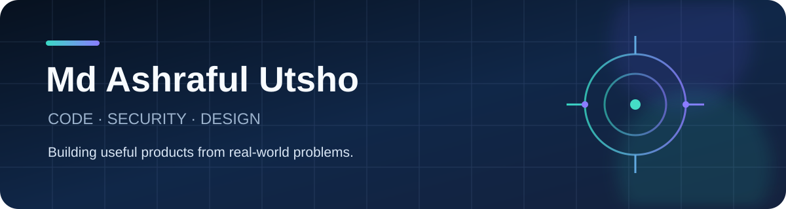

<div align="center">
  

  ### Engineer in progress · Builder by instinct · Clarity over clutter

  I turn real-world problems into useful digital products while growing at the intersection of **software engineering**, **cybersecurity**, and **design**.
</div>

## What makes me, me

```text
CODE       Java · Spring Boot · React · PostgreSQL
SECURITY   Cisco-trained cybersecurity foundations
DESIGN     Figma · Adobe XD · Photoshop · Premiere Pro
MINDSET    Curious · practical · people-focused
```

I am a Computer Science and Engineering student at **United International University**. My experience spans IT support, quality control, tutoring, customer-facing work, and community volunteering—so I care as much about how technology works for people as how it works in code.

## Currently

- Building secure, understandable full-stack applications
- Strengthening backend engineering and cybersecurity skills
- Turning business workflows into clean digital experiences

## Selected build

### Breaking Business

A full-stack platform that connects sales, expenses, teams, investments, analytics, and role-based access in one workspace.

`Java 21` · `Spring Boot` · `React` · `PostgreSQL` · `JWT` · `Flyway`

[Source repository](https://github.com/Cenobitee/breaking-business-platform) · [Deployment repository](https://github.com/Cenobitee/breaking-business-platform-vercel) · [Live application](https://breaking-business-platform-vercel-f.vercel.app)

---

<div align="center">
  <strong>Let's build something useful.</strong><br />
  <a href="https://www.linkedin.com/in/md-ashraful-utsho-5b2363270">LinkedIn</a>
</div>
